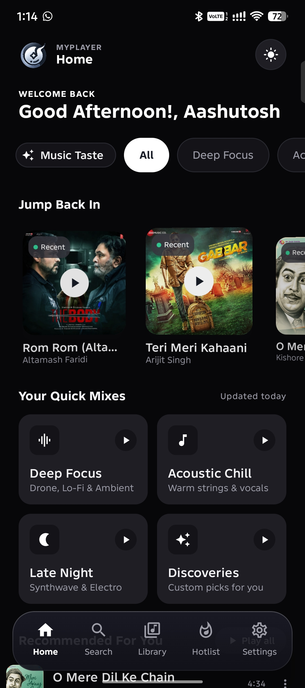
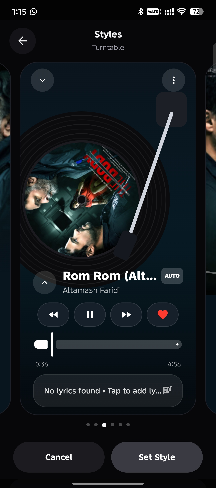
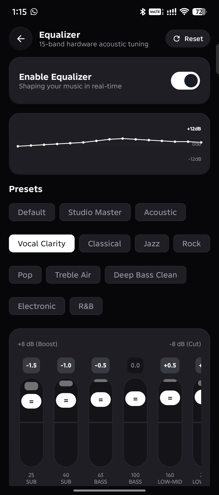
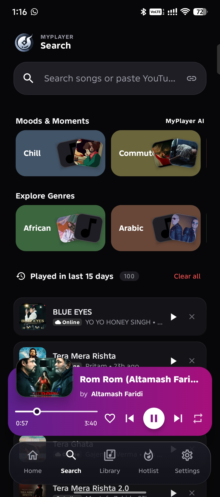
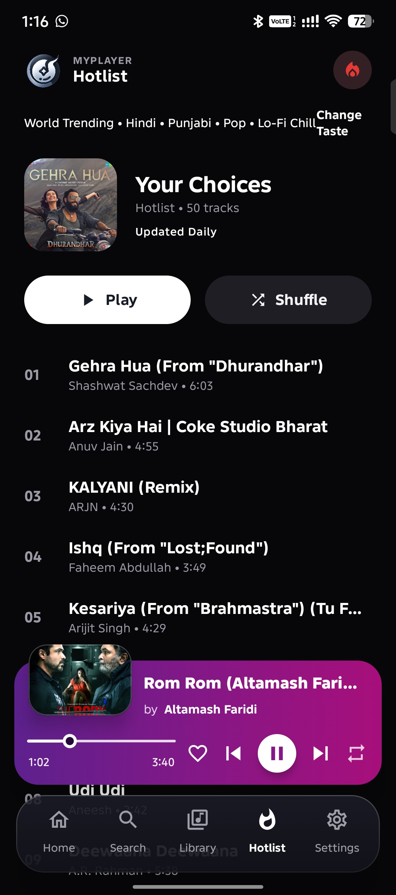
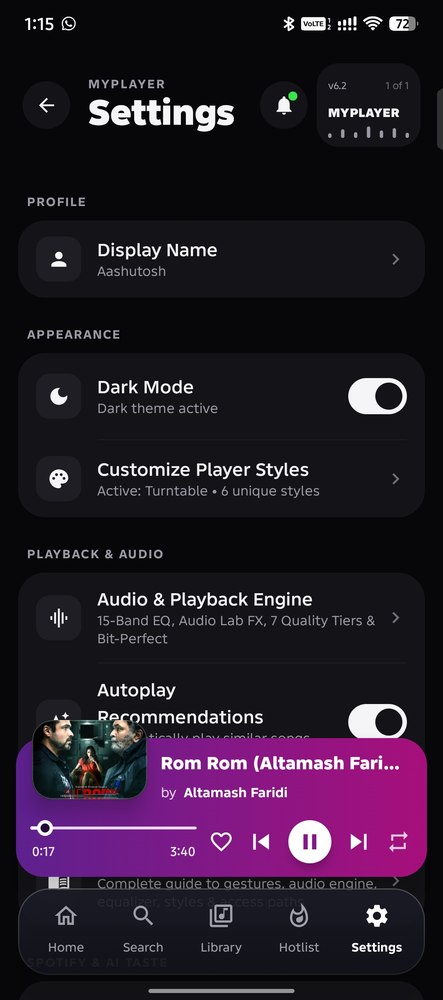
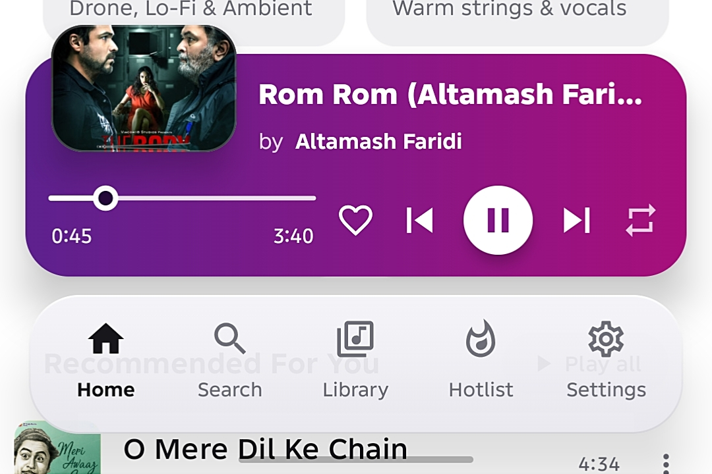

# 🎵 MyPlayer (Android)

<div align="center">

-3DDC84?style=for-the-badge&logo=android&logoColor=white)


<p align="center">
  <b>A state-of-the-art, high-performance Android music player crafted with Jetpack Compose, AndroidX Media3, and custom C++ DSP audio processing. Designed for locked 120 FPS fluid navigation, instant YouTube Music streaming, Studio Master acoustic enhancements, Apple-grade AutoMix crossfade, 6 dynamic Now Playing styles, offline synchronized lyrics & artwork, DualBud playback, and multi-device SyncPlay.</b>
</p>

<p align="center">
  <a href="https://github.com/Aashutosh2021/MyPlayer_Android/releases/latest">
    
  </a>
</p>

</div>

---

## 🌟 What's New in v6.2

- **🔗 Direct YouTube Link Search**: Paste any YouTube or YouTube Music link (`https://youtu.be/...`, `music.youtube.com/...`) directly into the search bar to stream, match, or download the exact song instantly.
- **⚡ Spotify-Grade 9-Second Rolling Chunk Engine**: 160 KB progressive audio chunking with 4x exponential backoff retries, HTTP `Content-Range` boundary tracking, and 30s timeouts. Starts audio in under 0.5s with zero stalls on slow 2G/3G and congested networks.
- **🎛️ Studio Master DSP & Audio Lab**: High-precision 10-band ISO equalizer, Studio Master clarity preset, dynamic sub-bass, 1.22x stereo widener, analog air exciter, and ReplayGain volume normalization.
- **🔀 Apple-Grade AutoMix & DJ Crossfade**: Seamless DJ transitions between songs with equal-power volume curves, automatic gapless silence trimming, and customizable transition durations.
- **🖼️ 100% Offline HD Posters & Artwork**: Auto-saves HD artwork (`filesDir/artwork/<videoId>.jpg` and companion `<song>.jpg`) during download, with instant `<1ms` offline fallback and zero battery waste.
- **📜 Offline Synced Lyrics & Companion `.LRC`**: Auto-saves synced `.lrc` companion files alongside downloaded tracks, SQLite Room caching with case-insensitive title/artist matching, and embedded ID3v2/MP4 lyrics extraction.
- **🔁 Infinite Repeat-One & Priority Routing**: Guard reset ensures seamless single-track looping; local downloaded tracks always take #1 playback priority over network caches.
- **🌙 True Dark Mode & Theme-Adaptive Docked Nav**: Dark aesthetic on initial launch, theme-adaptive floating pill navigation bar docked within Scaffold to prevent content overlap.

---

## ✨ Highlights & Key Features

### 🎧 Listening & Audio Engine
- **DualBud — Dual Audio Player**: Play two independent audio streams simultaneously—one in your left earbud and another in your right earbud with dedicated volume faders and scrubbers.
- **Studio Master DSP & 10-Band EQ**: Custom C++ and Media3 audio processors delivering audiophile sound clarity, analog presence, virtual surround spatialization, and customizable EQ presets.
- **Spotify-Style Progressive Chunking**: Audio streams buffer in rolling 9-second segments, saving up to 80% mobile data while guaranteeing instant startup even on weak cellular reception.
- **Unified Hybrid Playback**: Seamlessly browse, queue, and play both local on-device files and YouTube Music streams through a single unified Media3 ExoPlayer core.

### 🎨 Visuals & Personalization
- **6 Signature Now Playing Styles**:
  1. **Radial Dial**: Interactive 270° circular seek arc with gyroscope tilt and glowing aura rings.
  2. **Turntable Vinyl**: Realistic rotating vinyl disc animation with needle arm physics.
  3. **Editorial Poster**: Minimalist full-bleed magazine cover typography and soft gradient ambient lighting.
  4. **Timeline Waveform**: Dynamic audio waveform visualizer with scrubbable timeline cues.
  5. **Lyrics Stage**: Immersive karaoke-style synchronized lyrics view with auto-centering.
  6. **Classic Modern**: Clean Material 3 card layout with quick transport controls.
- **Electric Neon Lime & Dark Olive Aesthetic**: Custom design tokens featuring true-black backgrounds (`#12160E`), card surfaces (`#1A2216`), and vibrant electric neon lime accents (`#D2F83A`).
- **Real-Time Synchronized Lyrics**: Powered by LRCLIB with silky-smooth auto-scrolling, manual line seeking, custom lyric editor, and multi-script transliteration (Original, Latin, Devanagari).

### 🌐 Connectivity & Library Tools
- **SyncPlay (Multi-Device Listening)**: Host or join synchronized listening rooms over local Wi-Fi via Network Service Discovery (NSD) or direct IP to listen together in real-time.
- **Smart Offline Downloads**: High-speed multi-threaded audio downloader with companion `.lrc` and HD `.jpg` poster archiving for complete offline independence.
- **Smart Backup & Restore**: One-tap JSON backup and restore for playlists, favorites, play history, and equalizer presets across any Android device.
- **Intelligent Recommendations**: Contextual next-track discovery engine surfacing relevant songs based on current genre, artist, and playback habits.
- **Zero Ads, Zero Tracking**: 100% free and open-source forever. No accounts required, no telemetry, no banner ads, no subscriptions.

---

## 📸 Screenshots

<div align="center">
  <table align="center" width="100%">
    <tr>
      <td align="center" width="25%">
        <b>Home &amp; Radial Arc</b><br/><br/>
        
      </td>
      <td align="center" width="25%">
        <b>Radial Now Playing</b><br/><br/>
        
      </td>
      <td align="center" width="25%">
        <b>Custom Themes</b><br/><br/>
        
      </td>
      <td align="center" width="25%">
        <b>Studio Equalizer</b><br/><br/>
        
      </td>
    </tr>
    <tr>
      <td align="center" width="25%">
        <b>Direct Link Search</b><br/><br/>
        
      </td>
      <td align="center" width="25%">
        <b>Music Library</b><br/><br/>
        
      </td>
      <td align="center" width="25%">
        <b>Playlists &amp; Queue</b><br/><br/>
        
      </td>
      <td align="center" width="25%">
        <b>Offline Downloads</b><br/><br/>
        
      </td>
    </tr>
    <tr>
      <td align="center" width="25%">
        <b>Settings &amp; Audio Lab</b><br/><br/>
        
      </td>
      <td align="center" width="25%">
        <b>Trending Hotlist</b><br/><br/>
        
      </td>
      <td align="center" width="50%" colspan="2">
        <b>Miniplayer &amp; Persistent Navigation</b><br/><br/>
        
      </td>
    </tr>
  </table>
</div>

---

## 🏗️ Architecture & Technology Stack

MyPlayer is engineered following **Clean Architecture** principles and the **MVVM** pattern with strict Unidirectional Data Flow (UDF).

| Layer | Technologies / Libraries |
| :--- | :--- |
| **Language** | [Kotlin 2.0+](https://kotlinlang.org/) (Coroutines, StateFlow, Channel) |
| **UI Toolkit** | [Jetpack Compose](https://developer.android.com/jetpack/compose) with Material 3, Custom Tokens & Strong Skipping Mode |
| **Runtime Optimization** | [AndroidX Baseline Profiles](https://developer.android.com/topic/performance/baselineprofiles/overview) (AOT compilation for locked 120 FPS) |
| **Audio Core** | [AndroidX Media3](https://developer.android.com/guide/topics/media/media3) 1.3+ (`ExoPlayer`, `MediaSession`, `MediaController`) |
| **DSP Audio Engine** | Native **C++17** via CMake & NDK, custom `AudioProcessor` chain (ISO EQ, Spatializer, ReplayGain) |
| **Dependency Injection** | [Hilt](https://developer.android.com/training/dependency-injection/hilt-android) / Dagger with KSP |
| **Local Persistence** | [Room Database](https://developer.android.com/training/data-storage/room) & Jetpack DataStore Preferences |
| **Networking** | [OkHttp3](https://square.github.io/okhttp/) & Custom HTTP Range Chunk DataSources |
| **Streaming Extraction** | [NewPipeExtractor](https://github.com/TeamNewPipe/NewPipeExtractor) & [Mozilla Rhino](https://github.com/mozilla/rhino) JS Engine |
| **Image Loading** | [Coil Compose](https://coil-kt.github.io/coil/) (Hardware Bitmaps, Memory & Custom Disk Caching) |
| **Background Work** | [AndroidX WorkManager](https://developer.android.com/topic/libraries/architecture/workmanager) (Expedited Foreground Downloads) |
| **Multi-Device Sync** | Local Network Service Discovery (NSD) & TCP Socket Sync Barrier |

---

## 📁 Repository Structure

```text
MyPlayer_Android/
├── app/
│   ├── src/
│   │   ├── main/
│   │   │   ├── cpp/                 # Native C++17 DSP audio filters & CMake build script
│   │   │   ├── java/com/myplayer/app/
│   │   │   │   ├── aria/            # AI Assistant voice & automation connector SDK
│   │   │   │   ├── data/            # Room DAOs, Entities, Repositories, Innertube & Lyrics APIs
│   │   │   │   ├── di/              # Hilt Dependency Injection modules (PlayerModule, DatabaseModule)
│   │   │   │   ├── dualbud/         # Dual-channel audio routing & independent earbud mixer
│   │   │   │   ├── myplayerfx/      # Studio Master DSP, Equalizer, Reverb, Spatializer, ReplayGain
│   │   │   │   ├── playback/        # Media3 MusicController, PlaybackService, Crossfade, Chunking
│   │   │   │   ├── security/        # Play Integrity & runtime security verification
│   │   │   │   ├── sync/            # Multi-device Wi-Fi synchronized playback (Sync Play)
│   │   │   │   ├── ui/              # Compose screens (Home, Player, Search, Settings, Downloads)
│   │   │   │   └── util/            # Offline album art fetchers, tag helpers, image utils
│   │   │   └── res/                 # Vector drawables, mipmaps, XML configurations
│   │   └── test/                    # Comprehensive unit tests (DAOs, Artwork, Playback, Queue)
│   └── build.gradle.kts             # App build configuration (compileSdk 36, targetSdk 36, minSdk 28)
├── docs/                            # Architectural design documents & user guides
│   └── screenshots/                 # High-resolution app screenshots
├── gradle/                          # Gradle wrapper and version catalog (libs.versions.toml)
├── CONTRIBUTING.md                  # Open-source contribution guidelines
├── LICENSE                          # MIT Open Source License
└── README.md
```

---

## 🚀 Getting Started

### Prerequisites

- **Android Studio** Ladybug (2024.2.1+) or newer
- **JDK 17** or **JDK 21** (or Android Studio Embedded JBR)
- Android SDK configuration:
  - `compileSdk`: **36**
  - `minSdk`: **28** (Android 9.0 Pie)
  - `targetSdk`: **36** (Android 15+)
  - **CMake 3.22.1** and Android NDK (installed automatically via SDK Manager)

### Clone & Build

1. Clone the repository:
   ```bash
   git clone https://github.com/Aashutosh2021/MyPlayer_Android.git
   cd MyPlayer_Android
   ```

2. Open the project in Android Studio, or build via Gradle command line:
   ```bash
   ./gradlew assembleDebug
   ```

3. Build the production release APK with full R8 optimization:
   ```bash
   ./gradlew assembleRelease
   ```

4. Run the unit test suite:
   ```bash
   ./gradlew testDebugUnitTest
   ```

---

## ☕ Support Development

MyPlayer is developed as an independent, 100% free and open-source project with **no ads, no paywalls, and no tracking**.

If you enjoy using MyPlayer, consider supporting ongoing development:

- **UPI ID (GPay / PhonePe / Paytm)**: `gaashutoshgupta52-22@okaxis`
- Or use the in-app **"Buy Me a Coffee"** section located under **Settings**.

---

## 🤝 Contributing

Contributions are warmly welcome! Whether reporting a bug, proposing new features, or improving documentation:

1. Check open issues or start a GitHub discussion.
2. Fork the repository and create your feature branch:
   ```bash
   git checkout -b feature/amazing-feature
   ```
3. Commit your changes and ensure all tests pass:
   ```bash
   ./gradlew testDebugUnitTest
   ```
4. Submit a Pull Request targeting `main`.

Please review our [Contribution Guidelines](CONTRIBUTING.md) for details on code style and clean architecture practices.

---

## 📄 License

This project is licensed under the [MIT License](LICENSE).
